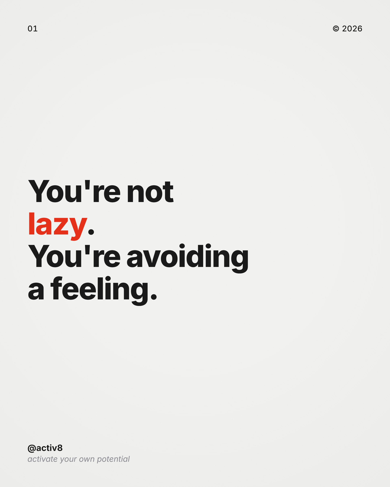

# Carousel Generator Kit

A local, free, code-only Instagram carousel generator — built around one
signature style: **Activate ("The Graphic Effect")**.

One giant bold-grotesque thought per card, one red moment, oceans of whitespace.
Everything is painted procedurally in code — no API keys, no image services, no
cost per slide. Copy is written with a built-in copywriting operating system so
every set flows as one continuous story.



## What you get

- **One locked style (Activate)** — every card identical in structure:
  - fixed type scale: **84px headline · 28px subtitle · 20px micro-caps source**
  - one sentence per card, **12 words max**
  - exactly **one red moment** per slide (`**text**` = white on red block,
    `*text*` = plain red type)
  - off-white paper `#F1F1F0`, ink `#1A1A1A`, red `#E5301A`
  - page number top-left, © top-right, handle + tagline footer
- **Verified-fact workflow** — numbers come from primary sources and are cited
  on-slide in a small tracked-caps credit line.
- **Fully offline rendering** — Python + Playwright paint each 1080×1350 (4:5)
  PNG from an HTML template. Internet is only needed the first time (fonts).

## Setup (once)

You need Python 3.10+. Then:

```bash
pip install playwright
playwright install chromium
```

That's it. No `.env`, no keys, no accounts.

## Quick start (manual flow)

```bash
# 1. Create a run folder with a starter plan
python carousel/scripts/carousel_run.py init "why you feel lazy"

# 2. Edit plan.json — write your copy into the scaffold
#    (6 slides pre-structured as hook -> proof -> mechanism -> recognition -> fix -> CTA)

# 3. Build all slides
python carousel/scripts/carousel_run.py build carousel/runs/<run-folder-name>
```

Final PNGs land in `carousel/output/<slug>/01.png … 06.png`, ready to post.

### Editing `plan.json`

Plan-level fields:

| field | meaning |
|---|---|
| `handle` | footer bold line (default `@activ8`) |
| `tagline` | footer italic line (default `activate your own potential`) |
| `slug` | output folder name |

Each slide:

| field | meaning |
|---|---|
| `headline` | the whole slide. `\n` splits stacked lines; `**text**` = white on red block, `*text*` = red type |
| `subtitle` | optional gray supporting line |
| `content.note` | list with one source citation string (keep it under ~58 chars so it fits one line) |
| `bg_seed` | unique per slide — never reuse a seed within a set |

Rules baked into the template: one sentence per card (12 words max), every
headline line ≤ ~17 characters (break into more lines instead of resizing),
and a `**highlight**` must never cross a `\n` line break — give each line its
own marks.

## Using it with Claude (the easy way)

This repo ships with a ready-made skill at
[`.claude/skills/carousel/`](.claude/skills/carousel/). If you open this folder
in Claude Code (or Claude Desktop with a project), the skill registers
automatically — just say:

> make a carousel about <your topic>

and it handles everything: research with verified sources, copy per the
copywriting OS, plan, build, and a visual check of every exported PNG.

## Creating your own template

Activate is the only bundled style, but the kit is template-agnostic. The
playbook for turning any reference design (a screenshot, a poster) into a new
template is in
[`carousel/knowledge/new-style-from-a-sheet.md`](carousel/knowledge/new-style-from-a-sheet.md).
Build it as a *second* template alongside Activate — never modify Activate.

## Repo layout

```
├── .claude/skills/carousel/   skill registration (auto-loads in Claude sessions)
│   └── SKILL.md               the operating manual the AI follows
├── carousel/
│   ├── scripts/               orchestrator, renderer, template, config
│   ├── knowledge/             copywriting OS, style specs, how-to-run docs
│   ├── assets/                style reference sheets (input material)
│   ├── runs/                  one run per carousel: plan.json + working files
│   └── output/                final PNGs, ready to post
```

## Example

`carousel/output/activate-laziness-myth/` is a finished 6-slide set built with
this kit ("You're not lazy. You're avoiding a feeling.") — look at it to see
the exact house style.

## Requirements

- Python 3.10+
- Playwright + Chromium (`pip install playwright && playwright install chromium`)
- Internet on first render (Google Fonts); after fonts cache, everything is local
